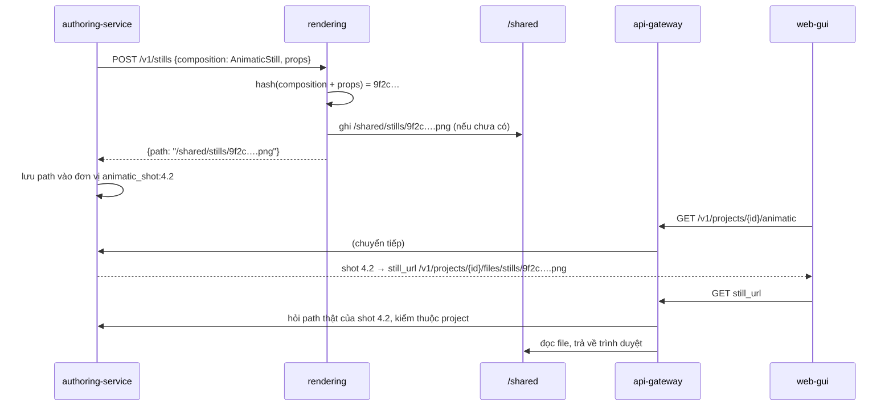
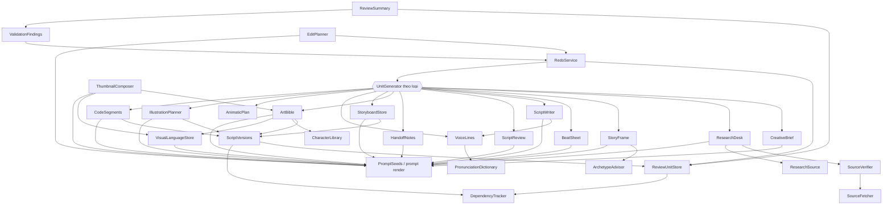

# CR-072 — Phụ thuộc và giao tiếp

## Ma trận giao tiếp giữa service

Dòng gọi cột. **mới** là đường giao tiếp CR-072 thêm; ô không ghi "mới" là đường đã có, chỉ thêm route hoặc trường.

| Bên gọi \ Bên nhận | api-gateway | orchestrator | authoring-service | llm-service | rendering | tts | video-assembly |
|---|---|---|---|---|---|---|---|
| web-gui | HTTP + SSE (đã có) | | | | | | |
| api-gateway | | HTTP (route mới: render theo cảnh, dựng) | HTTP (route mới: đơn vị, brief, nghiên cứu, câu chuyện, beat, kịch bản, rà soát, phiên bản kịch bản, mỹ thuật, ngôn ngữ hình, từ điển, animatic, thumbnail) | | | | |
| orchestrator | | | HTTP nội bộ (thêm: câu chờ đọc, kết quả đọc, kế hoạch dựng) | | RabbitMQ `render_scene` **mới** | RabbitMQ `synthesize_lines` **mới** | RabbitMQ `assemble_video` (thêm trường) |
| authoring-service | | HTTP nội bộ `draft-voice` **mới** (client đã có) | | HTTP (schema storyboard mới, code theo cảnh) | HTTP `/v1/stills`, `/v1/previews/shot` **mới**, `/v1/kits` **mới** | | |
| llm-service | | | | | HTTP `/v1/check/*` (đã có) | | |
| rendering, tts, video-assembly | `progress.fanout` (thêm `scene_key`, `stage`) | sự kiện RabbitMQ (mới: `scene_rendered`, `scene_render_failed`, `lines_synthesized`) | | | | | |

Không service nào gọi thẳng service khác ngoài các đường trên. tts và video-assembly vẫn chỉ nhận lệnh qua RabbitMQ.

**Ra ngoài hệ thống (mới, U3b):** authoring-service tải trang nguồn của dữ kiện qua `SourceFetcher` (HTTP GET tới Internet). Đây là đường duy nhất tới một địa chỉ do người ngoài đưa vào; luật chặn địa chỉ nội bộ và giới hạn ở ADR-0043. Không service nào khác dùng `SourceFetcher`.

## Lưu file: `/shared` là kho file (ADR-0041)

`/shared` được dùng như một server lưu file. Dữ liệu chỉ giữ đường dẫn; ai cần thì cầm đường dẫn đó để đọc file.

- **Nằm trên `/shared`**: mọi thứ nhị phân hoặc lớn (ảnh, giọng, video, file tải lên). DB, lệnh RabbitMQ và HTTP giữa service chỉ chở đường dẫn.
- **Nằm trong DB**: chữ nhỏ cần sửa, tra cứu, tính hash, ghi trong giao dịch (storyboard, prompt, luật, trạng thái và ghi chú đơn vị, code của shot, SVG/TSX của hình thư viện).
- **Một chủ ghi cho mỗi thư mục**; service khác chỉ đọc.
- **Tên file theo hash nội dung**: nội dung đổi thì đường dẫn đổi, không ghi đè file đang có người đọc.
- **Trình duyệt lấy file qua api-gateway**, theo đường dẫn lấy từ DB của chủ ghi; api-gateway kiểm đường dẫn nằm trong `/shared` và thuộc đúng project, như `videoHandler.js` đang làm.
- **Dọn file mồ côi** theo lịch, mỗi chủ ghi dọn thư mục của mình.

Ví dụ với một khung tĩnh của animatic:

Sửa khung tĩnh của shot 4.2 thì props đổi, hash đổi, file mới có tên mới; file cũ thành mồ côi và được dọn sau.

## Phụ thuộc dữ liệu qua `/shared`

Thêm vào `docs/contracts/shared-artifacts.md` (cập nhật cùng CR con tạo ra thư mục; `tests/contracts/test_shared_artifacts_contract.py` kiểm khớp):

| Đường dẫn | Chủ ghi | Người đọc | CR con |
|---|---|---|---|
| `/shared/stills/{hash}.png` | rendering | api-gateway (phát cho trình duyệt), publisher (thumbnail đã chọn được chép sang `thumbnail/`) | U1 |
| `/shared/{project_id}/audio/{line}_{cache_key}.wav` | tts | api-gateway (nghe thử ở Viết kịch bản, animatic), video-assembly | U3e (đọc từng câu, khoá theo chữ và giọng); U6 (thêm cách đọc vào khoá) |
| `/shared/{project_id}/previews/{scene}_{shot}_{hash}.mp4` | rendering | api-gateway | U7 |
| `/shared/{project_id}/video/scenes/{scene}.mp4` + `{scene}.json` (số khung, đoạn chồng) | rendering | video-assembly, api-gateway (màn Dựng) | U8 |
| `/shared/{project_id}/uploads/moodboard/`, `/uploads/svg/` | api-gateway | authoring-service | U4 |

`/shared/stills/` không thuộc project nào: ảnh tĩnh được khoá theo nội dung, nên hai project dùng cùng ảnh mẫu thì dùng chung một file. Ảnh không còn ai trỏ tới được dọn theo lịch; luật dọn chốt ở Functional Design của U1.

## Phụ thuộc giữa thành phần trong authoring-service

- Từ bước 8 trở đi, `ArtBible`, `StoryboardStore`, `IllustrationPlanner`, `CodeSegments` đọc kịch bản và ghi chú bàn giao qua `ScriptVersions` (bản đã chốt), không đọc thẳng đơn vị của bước 1–7 (ADR-0044).

- `ReviewUnitStore` và `DependencyTracker` không biết nội dung của từng loại đơn vị. Mỗi loại đăng ký một `UnitGenerator` khai báo đầu vào của nó. Thêm loại đơn vị mới không phải sửa khung.
- Mọi prompt vẽ và code đọc luật từ ngôn ngữ hình đã ghim vào project, qua `VisualLanguageStore`.

## Luồng dữ liệu tổng thể

```mermaid
flowchart LR
    subgraph ND[Tiền kỳ · Nội dung · authoring-service]
      YT[Ý tưởng] --> NC[Nghiên cứu · tuỳ chọn] --> CC[Câu chuyện] --> BTs[Beat sheet] --> VK[Viết kịch bản] --> RC[Rà soát và chốt]
      YT -. bỏ qua Nghiên cứu .-> CC
    end
    NC -. tải trang nguồn .-> NET[(Internet)]
    VK -. nghe thử · OR → tts .-> V
    subgraph TK[Tiền kỳ · Hình ảnh · authoring-service]
      M1[Mỹ thuật 1] --> SBo[Storyboard] --> M2[Mỹ thuật 2]
    end
    RC -- bản đã chốt + bộ bàn giao --> M1
    M2 --> V[Giọng sơ bộ · OR → tts]
    V --> AN[Animatic · trình duyệt]
    subgraph SX[Sản xuất · authoring-service]
      HM[Hình minh hoạ] --> CO[Code theo cảnh] --> VA1[Validate] --> RV[Review]
    end
    AN --> HM
    subgraph HK[Hậu kỳ · orchestrator]
      RD[Render từng cảnh · rendering] --> DG[Dựng] --> MG[Merge + QC · video-assembly] --> KQ[Kết quả] --> PB[Publish]
    end
    RV --> RD
    DG -. ghi chú .-> CO
    DG -. ghi chú .-> HM
    DG -. ghi chú .-> SBo
```

## Thứ tự làm và phụ thuộc giữa CR con

Theo `cr-072-workflow-plan.md`, cập nhật 2026-10-17; thứ tự và ma trận chi tiết theo CR con ở `unit-of-work-dependency.md`. Bảng dưới ghi thành phần nào của CR con trước mà CR con sau dùng:

| CR con | Dùng của CR con trước |
|---|---|
| U2a | — |
| U3a | U2a: thanh bước bốn nhóm, cách thêm bước |
| U3b..U3f | U3a: khung đơn vị (`ReviewUnitStore`, `DependencyTracker`, `RedoService`, bộ thành phần đơn vị của web-gui); bước trước của chính Tiền kỳ · Nội dung (`brief` → `fact` → `story` → `beat` → `script_beat`) |
| U4 | U1: `VisualLanguageStore`, `LanguageKits`, `/v1/stills`; U3a: khung đơn vị; U3f: `script_version` và bộ bàn giao |
| U5 | U4: `art_*`, `CharacterLibrary`, schema storyboard có nhân vật |
| U6 | U5: `board_scene` (câu thoại), `art_*` cho khung tĩnh; U3e: `SynthesizeLines`, `DraftVoiceDispatcher`, phát file chung |
| U7 | U5: storyboard mới; U3a: khung đơn vị cho `code_shot` |
| U8 | U7: code theo cảnh; U5: color key, cách nối cảnh |
| U9 | U5: `style_frame`; U1: `/v1/stills` |

## Đổi hợp đồng theo ba bước

| Hợp đồng | Bản mới | Bản cũ giữ tới | Bỏ bản cũ khi |
|---|---|---|---|
| Lệnh render | `render_scene` theo cảnh | `render_scenes` cả video | U8 chạy ổn trên stack thật; ghi vào backlog |
| Code | `/v2/code/generate` với `segment_kind = "scene"` | đoạn theo số shot (CR-050) | U7 xong |
| Storyboard | thêm trường (nhân vật, color key, cách nối) | — (chỉ thêm trường, bên nhận cũ bỏ qua được) | — |
| `assemble_video` | thêm `scenes[]` | trường `video_path` một file | U8 xong |
