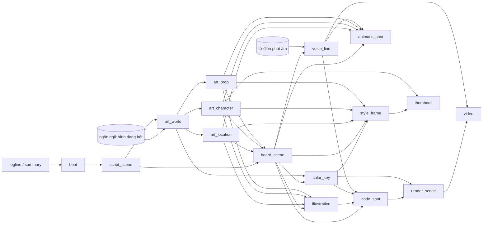

# CR-072 — Thành phần

Thành phần mới (**mới**) và thành phần đổi (**đổi**) của luồng làm phim 2D. Ranh giới theo ADR-0029: authoring-service giữ mọi thứ AI soạn; orchestrator giữ project, luồng và saga; các service còn lại nhận lệnh qua RabbitMQ hoặc HTTP như hiện nay. Cột "CR con" là nơi thành phần được làm (`cr-072-workflow-plan.md`).

## Khái niệm chung: đơn vị duyệt (ADR-0035)

Một **đơn vị** là thứ nhỏ nhất Creator duyệt, ghi chú, sửa tay hoặc cho làm lại. Đơn vị được gọi bằng `kind:key`, ví dụ `board_scene:3`, `voice_line:3.2`, `art_location:ostiole`.

Mỗi đơn vị có:
- **trạng thái**: `pending` (chờ duyệt), `approved`, `redoing` (AI đang làm lại), `stale` (đầu vào đã đổi, cần làm lại);
- **nguồn**: `ai` hoặc `creator` (Creator sửa tay hoặc tự viết; AI không ghi đè, trừ khi Creator bấm làm lại);
- **ghi chú** của Creator (nhiều ghi chú, gom được);
- **dấu đầu vào**: hash của các đơn vị nó được dựng từ, lúc dựng. Đầu vào đổi thì đơn vị thành `stale` (AD-2 A);
- **số lần làm lại**, để tính tỉ lệ duyệt ngay lần đầu (NFR-2).

Đồ thị phụ thuộc giữa các loại đơn vị:

Đơn vị `render_scene` và ghi chú dựng do orchestrator giữ; các đơn vị còn lại do authoring-service giữ (AD-1 A).

## authoring-service (Go)

| Thành phần | Mới/đổi | Trách nhiệm | FR | CR con |
|---|---|---|---|---|
| `VisualLanguageStore` | mới | Ngôn ngữ hình của kênh: luật hình, luật nền, mô tả, `kit_key` trỏ tới kit Remotion; phiên bản; đúng một ngôn ngữ bật; ngôn ngữ hệ thống chỉ đọc, sao chép để sửa; ghim ngôn ngữ và phiên bản vào project khi tạo (AD-3 A) | FR-18 | U1 |
| `ReviewUnitStore` | mới | Lưu đơn vị: trạng thái, nguồn, ghi chú, dấu đầu vào, số lần làm lại | FR-17, NFR-2 | U2 |
| `DependencyTracker` | mới | Tính dấu đầu vào, đánh `stale` khi đầu vào đổi, trả danh sách "sẽ làm lại" trước khi Creator sửa | FR-17 | U2 |
| `RedoService` | mới | Làm lại một đơn vị kèm ghi chú, hoặc gom ghi chú của nhiều đơn vị thành một lượt; đưa đơn vị bên cạnh vào ngữ cảnh; gọi bộ sinh của từng loại đơn vị; chạy bất đồng bộ qua `/v1/operations/{id}` hiện có | FR-17 | U2 |
| `ScriptAuthoring` | đổi | Logline, tóm tắt, dàn ý theo beat, lời thoại theo cảnh; giữ chữ Creator tự viết; mỗi cảnh một đơn vị | FR-2 | U3 |
| `ArchetypeAdvisor` | mới | Gợi ý 3–5 kiểu video từ bảng `video_archetypes` theo chủ đề, mỗi kiểu có lý do và câu mở mẫu; đề xuất kiểu mới kèm playbook nháp, lưu vào bảng được | FR-19 | U3 |
| `ArtBible` | mới | Bộ thiết kế mỹ thuật: thế giới, bối cảnh, nhân vật, đạo cụ (lượt 1); color key, khung mẫu (lượt 2); bảng tham khảo, ảnh Creator tải lên; mỗi mục một đơn vị; nhờ rendering dựng ảnh tĩnh | FR-3, FR-5, FR-6 | U4, U5 |
| `CharacterLibrary` | mới | Thư viện nhân vật kênh: model sheet, biểu cảm, tư thế; dùng lại ở video sau; nằm cạnh thư viện hình (`illustrations`) | FR-4 | U4 |
| `StoryboardStore` | đổi | Storyboard theo cảnh, mỗi cảnh một đơn vị; nhân vật gọi theo tên kèm biểu cảm và tư thế; color key theo cảnh; cách nối sang cảnh sau; cảnh giải thích ý đặt trong thế giới | FR-6..FR-8 | U4, U5 |
| `PronunciationDictionary` | mới | Từ điển phát âm của kênh; tra từ điển cho từng câu trước khi gửi lệnh đọc (AD-7 A) | FR-20 | U6 |
| `VoiceLines` | mới | Đơn vị câu giọng: chữ, "đọc là", tốc độ, khoảng nghỉ, đường dẫn file, thời lượng; nhận kết quả đọc do orchestrator chuyển về | FR-9, FR-20 | U6 |
| `AnimaticPlan` | mới | Kế hoạch animatic: mỗi shot có khung tĩnh, thời lượng (kể cả chỉnh tay), câu, file giọng; ghi chú nhịp cảnh và đề xuất của AI. Không dựng video (AD-5 C) | FR-10 | U6 |
| `IllustrationPlanner` | đổi | Danh sách hình chỉ gồm phần còn thiếu sau bộ mỹ thuật; hình của bộ mỹ thuật hiện là đã duyệt, sửa ở mục gốc | FR-13 | U4 |
| `CodeSegments` | đổi | Đoạn code là một cảnh; trạng thái từng shot; bỏ lượt AI tự sửa, giữ autofix máy móc và ghi lại đã sửa gì; yêu cầu xem nhanh từng shot | FR-22 | U7 |
| `ValidationFindings` | đổi | Mỗi phát hiện chỉ tới đơn vị; "AI sửa chỗ này" chỉ chạy khi Creator bấm; bỏ qua cảnh báo có ghi lại; kiểm lại riêng đơn vị đã sửa | FR-23 | U7 |
| `ReviewSummary` | mới | Đọc tổng hợp cho màn Review: chỗ duyệt, cảnh báo đã bỏ qua, thời lượng từng phần, ước tính render, chi phí, tỉ lệ duyệt ngay lần đầu, thứ sẽ vào thư viện | FR-24 | U7 |
| `EditPlanner` | mới | Nhận ghi chú dựng theo mốc thời gian (từ orchestrator), đề xuất tầng sửa cho từng ghi chú (code, hình, nội dung) và danh sách sẽ làm lại | FR-25 | U8 |
| `ThumbnailComposer` | mới | 3 phương án thumbnail dựng bằng Remotion từ hình của video; prompt cho công cụ tạo ảnh ngoài sinh từ ngôn ngữ hình, thế giới, bảng màu | FR-21 | U9 |
| `PromptSeeds` | đổi | Prompt hệ thống viết lại cho luồng mới; luật hình và nền theo từng ngôn ngữ | FR-15 | U1..U9 |

## orchestrator (Go)

| Thành phần | Mới/đổi | Trách nhiệm | FR | CR con |
|---|---|---|---|---|
| `FlowDefinition` | đổi | Luồng 17 bước, 3 giai đoạn; suy ra bước và trạng thái từ nội dung đã có; giữ ba bản (đây, authoring-service, web-gui) cùng test hợp đồng (AD-9 A) | FR-1 | U2 |
| `DraftVoiceDispatcher` | mới | Gửi lệnh đọc các câu khi storyboard được duyệt hoặc một câu đổi, ngoài saga render; nhận kết quả, chuyển cho authoring-service (AD-6 A) | FR-9 | U6 |
| `RenderSaga` | đổi | Mỗi cảnh một lệnh render; trạng thái từng cảnh; tự thử lại một lần với lỗi tạm thời; huỷ, chạy lại từng cảnh; truyền đoạn chồng và color key (AD-8 A) | FR-14 | U8 |
| `EditSession` | mới | Đơn vị `render_scene` và ghi chú dựng theo mốc thời gian; xin authoring-service đề xuất tầng sửa; chạy kế hoạch đã được Creator đồng ý | FR-25 | U8 |

## llm-service (Python)

| Thành phần | Mới/đổi | Trách nhiệm | FR | CR con |
|---|---|---|---|---|
| `storyboard` schema | đổi | Model Pydantic mới: nhân vật tham chiếu, color key theo cảnh, cách nối cảnh, cảnh giải thích ý trong thế giới; `finalize` theo cảnh | FR-4, FR-6..FR-8 | U4, U5 |
| `pipeline` code | đổi | Sinh code theo cảnh; bỏ vòng sửa bằng AI; giữ autofix máy móc; trả chẩn đoán theo shot | FR-22 | U7 |

## rendering (Python + Remotion)

| Thành phần | Mới/đổi | Trách nhiệm | FR | CR con |
|---|---|---|---|---|
| `LanguageKits` | mới | Bốn kit Remotion (`tuoi`, `phatsang`, `giay`, `net`): rig cơ sở và hình nền tảng theo từng ngôn ngữ; registry theo `kit_key` | FR-18 | U1 |
| `StillRenderService` | mới (mở rộng `/v1/illustrations/preview`) | Một API ảnh tĩnh chung: composition + props → PNG; hàng đợi; cache theo nội dung (AD-4 A) | FR-3, FR-10, FR-18, FR-21 | U1 |
| Compositions ảnh tĩnh | mới | `LanguageSample`, `ArtSheet`, `ColorKeyFrame`, `StyleFrame`, `AnimaticStill`, `Thumbnail` | FR-3, FR-10, FR-18, FR-21 | U1..U9 |
| `ShotPreview` | mới | Render nhanh 480p riêng một shot, cho bước Code | FR-22 | U7 |
| `rig` key pose, `vfx` | đổi, mới | Rig diễn theo key pose có giữ dáng, ease mạnh, vượt đà; bộ hiệu ứng có tên lấy màu từ bảng màu | FR-11, FR-12 | U7 |
| `SceneRenderer` | đổi | Render một cảnh, thêm đoạn chồng ở chỗ nối liền mạch, chỉnh màu theo color key, báo tiến độ theo khung, phân biệt lỗi tạm thời và lỗi do code | FR-14 | U8 |

## tts (Python)

| Thành phần | Mới/đổi | Trách nhiệm | FR | CR con |
|---|---|---|---|---|
| `SynthesizeLines` | đổi | Nhận lệnh đọc từng câu kèm "đọc là", tốc độ, khoảng nghỉ; dựng SSML Azure; cache theo nội dung và cách đọc | FR-9, FR-20 | U6 |

## video-assembly (Python)

| Thành phần | Mới/đổi | Trách nhiệm | FR | CR con |
|---|---|---|---|---|
| `SceneAssembler` | đổi | Ghép file theo cảnh, cắt đoạn chồng ở chỗ nối liền mạch, áp chuyển cảnh ở chỗ cắt; báo tiến độ theo chặng | FR-14, FR-26 | U8 |
| `qc_rules` | đổi | Thêm kiểm chỗ nối khớp và khung đen hoặc khung trống; mọi kết quả là cảnh báo | FR-26 | U8 |

## api-gateway (Node)

| Thành phần | Mới/đổi | Trách nhiệm | FR | CR con |
|---|---|---|---|---|
| Route chuyển tiếp | đổi | Chuyển các route mới tới authoring-service và orchestrator | tất cả | U1..U9 |
| Phát file | đổi | Một cách phát file chung cho mọi file trên `/shared` (ảnh tĩnh, giọng từng câu, xem nhanh shot, video theo cảnh): lấy đường dẫn từ DB của chủ ghi, kiểm nằm trong `/shared` và thuộc đúng project, hỗ trợ tua, như `videoHandler.js` đang làm (ADR-0041) | FR-10, FR-14, FR-22 | U1 |
| Tải file lên | mới | Ảnh tham khảo của bảng tham khảo, file SVG thay hình | FR-3 | U4 |

## web-gui (React)

| Thành phần | Mới/đổi | Trách nhiệm | FR | CR con |
|---|---|---|---|---|
| `StepRail` theo giai đoạn | đổi | Thanh bước chia Tiền kỳ, Sản xuất, Hậu kỳ | FR-1 | U2 |
| Bộ thành phần đơn vị | mới | Thẻ đơn vị (trạng thái, duyệt, làm lại kèm ghi chú, sửa tay), thanh gom ghi chú, hộp "sẽ làm lại", nút duyệt tất cả mục còn lại | FR-17 | U2 |
| Màn Kịch bản | đổi | Logline, tóm tắt, beat, lời thoại theo cảnh; gợi ý kiểu video ở bước Khởi tạo | FR-2, FR-19 | U3 |
| Màn Mỹ thuật lượt 1, lượt 2 | mới | Các tab thế giới, bối cảnh, nhân vật, đạo cụ; color key, khung mẫu | FR-3..FR-6 | U4, U5 |
| Màn Storyboard | đổi | Duyệt, sửa, ghi chú theo cảnh và shot; hành trình máy quay | FR-7, FR-8, FR-17 | U5 |
| Màn Giọng sơ bộ | mới | Bảng câu, sửa chữ, "đọc là", đọc lại một câu | FR-9, FR-20 | U6 |
| `AnimaticPlayer` | mới | Phát animatic trong trình duyệt từ ảnh tĩnh, file giọng và mốc thời gian; sửa từng shot (AD-5 C) | FR-10 | U6 |
| Màn Code, Validate, Review | đổi | Trạng thái theo shot, xem nhanh shot, phát hiện chỉ đúng chỗ, Review đủ thông tin | FR-22..FR-24 | U7 |
| Màn Render, Dựng, Merge | đổi, mới | Trạng thái từng cảnh; ghi chú theo mốc thời gian; tiến độ theo chặng và bảng QC | FR-14, FR-25, FR-26 | U8 |
| Màn Publish | đổi | 3 thumbnail Remotion sửa được chữ; prompt cho công cụ ngoài | FR-21 | U9 |
| Trang cài đặt | mới | Ngôn ngữ hình (U1), Thư viện nhân vật (U4), Từ điển phát âm (U6) | FR-4, FR-18, FR-20 | U1, U4, U6 |

## Thao tác vận hành một lần

| Việc | Trách nhiệm | FR | CR con |
|---|---|---|---|
| Sao lưu và xoá dữ liệu cũ | Dump DB của orchestrator và authoring-service, nén `/shared`; rồi xoá project, file project, prompt Creator sửa, luật style, thư viện hình và nền. Giữ kiểu video, cấu hình kênh, kết nối YouTube. Chạy khi U1 vào main (W-2 A). Dạng script có bước xác nhận, không phải tính năng trong app | FR-16 | U1 |
