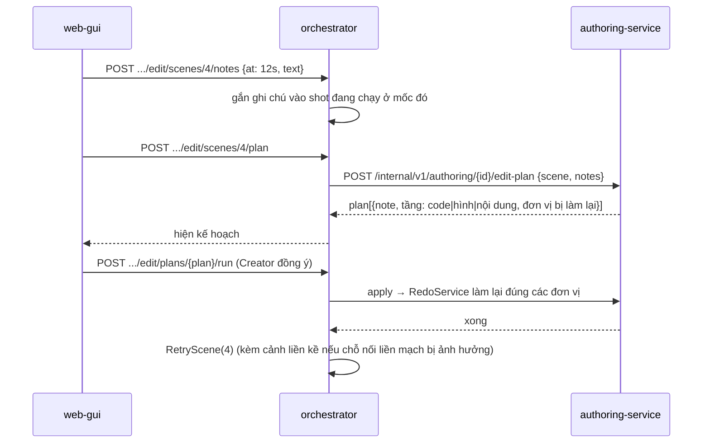

# CR-072 — Điều phối giữa các service

Mỗi chặng của luồng 21 bước (ADR-0042): ai khởi động, ai làm, kết quả nằm ở đâu, Creator duyệt chỗ nào. Ký hiệu: **GW** api-gateway, **AU** authoring-service, **OR** orchestrator, **LLM** llm-service, **RE** rendering, **TTS**, **VA** video-assembly.

## Mẫu chung: một đơn vị được dựng, duyệt, sửa (ADR-0035)

```mermaid
sequenceDiagram
    participant W as web-gui
    participant AU as authoring-service
    participant G as UnitGenerator (theo loại)
    participant LLM as llm-service
    participant RE as rendering
    W->>AU: POST .../units/{kind}/{key}/redo {note}
    AU->>AU: đơn vị → redoing; lấy đơn vị bên cạnh làm ngữ cảnh
    AU-->>W: operation_id
    AU->>G: Generate(project, ref, note, neighbours)
    G->>LLM: /v1/chat hoặc /v2/code/* (prompt theo ngôn ngữ hình đang ghim)
    G->>RE: POST /v1/stills (nếu đơn vị có ảnh)
    G-->>AU: content, inputs
    AU->>AU: lưu content; MarkBuilt(ref, inputs); đơn vị → pending
    AU->>AU: DependencyTracker: đơn vị phụ thuộc vào ref → stale
    W->>AU: GET .../units (thấy pending và các đơn vị stale)
```

- **Sửa tay**: `PUT .../units/{kind}/{key}`. Đơn vị đổi nguồn thành `creator`; các đơn vị phụ thuộc thành `stale`. Trước khi lưu, web-gui gọi `GET .../impact` để hiện "sẽ làm lại".
- **Gom ghi chú**: `POST .../units/redo-notes` chạy một lượt cho mọi đơn vị có ghi chú trong phạm vi; mỗi đơn vị được làm lại với ghi chú của chính nó.
- **Duyệt bước**: bước đi tiếp được khi mọi đơn vị của bước là `approved` và không còn `stale`.

## Tiền kỳ · Nội dung

| Chặng | Khởi động | Thực hiện | Kết quả | Duyệt |
|---|---|---|---|---|
| 1 Ý tưởng | Creator nhập đề tài, bấm "Tạo project và viết brief" | OR tạo project (thêm thời lượng mục tiêu); AU `GenerateBrief` (LLM); ngôn ngữ hình ghim vào project (AU, từ U1) | `brief` | brief |
| 2 Cấu hình | Creator | OR, AU lưu cài đặt (giọng chọn ở đây dùng cho nghe thử ở bước 6) | — | — |
| 3 Nghiên cứu (tuỳ chọn) | duyệt brief xong | AU `GenerateQuestions` (LLM); AU dựng prompt; Creator chạy ở công cụ ngoài, dán lại; AU `IngestPaste`, `SourceVerifier` tải trang qua `SourceFetcher` (dưới) | `research_question`, `fact` | bảng dữ kiện; hoặc bỏ qua |
| 4 Câu chuyện | duyệt hoặc bỏ qua Nghiên cứu | AU `SuggestArchetypes`, `GenerateStory` (LLM); bỏ qua Nghiên cứu thì LLM tự liệt kê dữ kiện "chưa có nguồn" | `story` (và `fact` "chưa có nguồn") | câu chuyện |
| 5 Beat sheet | duyệt câu chuyện | AU `GenerateBeats` (LLM); máy kiểm cấu trúc | `beat` | từng beat |
| 6 Viết kịch bản | duyệt beat | AU `GenerateLines` (LLM) theo beat; máy và LLM tìm câu dài, khó nghe, chỗ nối; AU → OR `draft-voice` → TTS đọc từng câu (dưới, "Giọng sơ bộ") | `script_beat`; file giọng từng câu | lời thoại từng beat |
| 7 Rà soát và chốt | duyệt mọi beat lời thoại | AU `RunReview` (máy kiểm + LLM), `GenerateHandoff` (LLM); Creator chốt → AU `ScriptVersions.Lock` (dưới) | `review_check`, `handoff_beat`, `glossary_term`; `script_version` | mục rà soát; ghi chú từng beat; chốt |

### Nghiên cứu: dán kết quả và kiểm link (ADR-0043)

```mermaid
sequenceDiagram
    participant W as web-gui
    participant AU as authoring-service
    participant F as SourceFetcher
    participant WEB as trang nguồn (Internet)
    W->>AU: GET .../research/prompt
    AU-->>W: prompt (brief, câu hỏi, luật nguồn, mẫu JSON)
    Note over W: Creator chạy prompt ở công cụ ngoài, chép câu trả lời
    W->>AU: POST .../research/paste {raw}
    AU->>AU: tìm khối JSON, kiểm từng dòng, gộp theo mã; ghi nhật ký lần dán
    AU-->>W: added, updated, rejected[{row, reason}]
    AU->>AU: dữ kiện có link → trạng thái "đang kiểm"; chạy nền
    loop mỗi dữ kiện, giới hạn số trang cùng lúc
        AU->>F: Fetch(url)
        F->>F: chỉ http/https; phân giải tên → chặn loopback, mạng riêng, link-local, metadata, tên trong mạng Docker
        F->>WEB: GET (giới hạn thời gian, dung lượng; mỗi lần chuyển hướng kiểm lại)
        WEB-->>F: HTML / văn bản
        F-->>AU: chữ của trang, hoặc lỗi kèm lý do
        AU->>AU: chuẩn hoá, tìm đoạn trích → khớp / không khớp (câu gần nhất) / không tải được
    end
    W->>AU: GET .../units?kind=fact (thấy kết quả)
```

- Sửa link hoặc đoạn trích của một dữ kiện thì chỉ dữ kiện đó được kiểm lại.
- Đổi, bỏ một dữ kiện thì đơn vị dùng nó (`story`, `beat`, `script_beat`) thành `stale` hoặc được rà soát lại ở bước 7; dữ kiện chưa ai dùng thì không kéo theo gì.

### Chốt phiên bản kịch bản (ADR-0044)

```mermaid
sequenceDiagram
    participant W as web-gui
    participant AU as authoring-service
    W->>AU: GET .../script-versions/draft
    AU->>AU: so hash từng phần (brief, dữ kiện dùng, câu chuyện, từng beat, lời thoại, ghi chú bàn giao, thuật ngữ) với bản chốt gần nhất
    AU-->>W: danh sách thay đổi
    W->>AU: GET .../script-versions/draft/impact
    AU-->>W: đơn vị từ bước 8 trở đi phụ thuộc phần đổi (hoặc cả bước, nếu bước đó chưa theo đơn vị)
    W->>AU: POST .../script-versions {note} (sau hộp xác nhận)
    AU->>AU: kiểm điều kiện chốt; ghi ảnh chụp bất biến vN+1
    AU->>AU: DependencyTracker: đơn vị trỏ vào phần đổi của vN → stale
    AU-->>W: vN+1
```

- Các vai AI phía sau gọi `HandoffFor(role)` và nhận đúng phần chúng đọc của bản đã chốt (FR-32 mục 4).
- Sửa ở bước 1–7 sau khi chốt không đụng tới bước 8 trở đi tới khi Creator chốt bản mới.

## Tiền kỳ · Hình ảnh

| Chặng | Khởi động | Thực hiện | Kết quả | Duyệt |
|---|---|---|---|---|
| 8 Mỹ thuật lượt 1 | chốt kịch bản | AU `GenerateArtPass(1)`: mô tả (LLM), hình SVG/TSX theo kit của ngôn ngữ (LLM), ảnh tĩnh (RE `/v1/stills`); đọc bộ bàn giao của bản đã chốt | `art_world`, `art_location`, `art_character`, `art_prop` | từng mục |
| 9 Storyboard | duyệt lượt 1 xong | AU theo cảnh (LLM, `/v1/storyboard/finalize` schema mới); đọc lời thoại và ghi chú bàn giao của bản đã chốt | `board_scene` | từng cảnh |
| 10 Mỹ thuật lượt 2 | duyệt storyboard xong | AU `GenerateArtPass(2)`: color key, khung mẫu (RE `/v1/stills`) | `color_key`, `style_frame` | từng mục |
| 11 Giọng sơ bộ | duyệt lượt 2 xong (tự chạy) | OR `DispatchLines` → TTS → OR → AU (dưới); câu đã đọc ở bước 6 mà chữ và cách đọc không đổi thì dùng lại file | `voice_line` | — |
| 12 Animatic | giọng xong | AU `AnimaticPlanFor`; RE dựng ảnh tĩnh từng shot; web-gui phát trong trình duyệt (ADR-0039) | `animatic_shot` | chốt nhịp |

### Giọng sơ bộ và nghe thử (ADR-0040)

Cùng một đường dùng cho hai chỗ: nghe thử từng câu và ước tính thời lượng ở bước 6 Viết kịch bản (U3e: chỉ chữ và giọng), và Giọng sơ bộ ở bước 11 (U6: thêm từ điển phát âm, "đọc là", tốc độ, khoảng nghỉ).

```mermaid
sequenceDiagram
    participant AU as authoring-service
    participant OR as orchestrator
    participant TTS as tts
    participant SH as /shared
    AU->>OR: POST /internal/v1/projects/{id}/draft-voice (lời thoại một beat vừa viết hoặc sửa; lượt 2 vừa duyệt; một câu vừa đổi)
    OR->>AU: GET /internal/v1/authoring/{id}/voice-lines?pending=1
    AU->>AU: tra từ điển phát âm, gắn cách đọc từng câu
    AU-->>OR: lines[{line_id, text, say_as, speed, pauses}]
    OR->>TTS: synthesize_lines (RabbitMQ)
    TTS->>SH: ghi file theo cache_key (nội dung + cách đọc)
    TTS-->>OR: lines_synthesized
    OR->>AU: POST /internal/v1/authoring/{id}/voice-lines/results
    AU->>AU: câu có file, thời lượng (ước tính thời lượng kịch bản); từ U6: voice_line, animatic_shot phụ thuộc → stale
```

authoring-service tự gọi orchestrator khi có câu cần đọc (đã có client tới orchestrator, hiện dùng để đọc project), nên việc đọc không phụ thuộc trình duyệt còn mở. Trình duyệt phát file giọng qua cách phát file chung của api-gateway (ADR-0041), làm ở U3e. Creator sửa một câu (chữ hoặc cách đọc) thì chỉ câu đó vào lại danh sách chờ đọc. Bước TTS của saga sau này gửi `synthesize_speech` như cũ; file đã có theo cùng `cache_key` được dùng lại.

### Animatic trong trình duyệt (ADR-0039)

- web-gui gọi `GET /v1/projects/{id}/animatic`: mỗi shot có `still_url`, `audio_url`, `start`, `duration`, `line`.
- Ảnh tĩnh và file giọng được GW phát từ `/shared`, cùng cách `videoHandler.js` phát video.
- `AnimaticPlayer` xếp hình theo mốc thời gian, phát giọng từng câu, hiện phụ đề. Không có lượt render video nào.
- Sửa thời lượng chỉ đổi dữ liệu. Sửa câu thì đọc lại câu đó. Đổi khung tĩnh thì chỉ dựng lại ảnh tĩnh của shot đó.

## Sản xuất

| Chặng | Khởi động | Thực hiện | Kết quả | Duyệt |
|---|---|---|---|---|
| 13 Hình minh hoạ | chốt nhịp | AU `IllustrationPlanner` (chỉ phần thiếu), LLM vẽ, RE xem trước; đọc "phải giữ chính xác", thuật ngữ, "điểm chưa chắc" của bản đã chốt | `illustration` | từng hình (như hiện nay) |
| 14 Code | hình xong | AU `GenerateScene` từng cảnh (LLM `/v2/code/generate`, đoạn = cảnh); RE `/v1/check/remotion`; đọc "được phép sáng tạo" | `code_shot` | shot lỗi chờ Creator chọn cách xử lý |
| 15 Validate | code xong | AU gom chẩn đoán; kiểm hình theo "phải giữ chính xác"; `FixFinding` chỉ khi Creator bấm | `Finding` | cảnh báo: bỏ qua hoặc sửa |
| 16 Review | validate xong | AU `Summary` | — | bắt đầu render |

Xem nhanh một shot: web-gui → AU `ShotPreview` → RE `POST /v1/previews/shot` (480p) → GW phát file.

Shot lỗi: llm-service trả chẩn đoán theo shot. Autofix máy móc chạy và được ghi lại; không có lượt AI tự sửa. Creator chọn chạy lại, chạy lại kèm ghi chú, sửa tay hoặc dán kết quả AI ngoài (giữ từ CR-050).

## Hậu kỳ

### Render từng cảnh (ADR-0038)

```mermaid
sequenceDiagram
    participant OR as orchestrator
    participant RE as rendering
    participant SH as /shared
    participant W as web-gui
    OR->>RE: render_scene × N (mỗi cảnh một lệnh; đoạn chồng, color key)
    RE-->>W: tiến độ theo khung (progress.fanout, có scene_key)
    RE->>SH: /shared/{id}/video/scenes/{scene}.mp4
    RE-->>OR: scene_rendered
    RE-->>OR: scene_render_failed {transient: true}
    OR->>RE: render_scene (thử lại một lần)
    RE-->>OR: scene_render_failed {transient: false, shot_key, frame}
    OR-->>W: cảnh chờ Creator: "Sửa shot lỗi" (mở bước Code) hoặc "Chạy lại cảnh"
```

- rendering nhận nhiều lệnh `render_scene` cùng lúc theo số worker cấu hình (chi tiết số worker ở NFR Design của U8).
- Huỷ một cảnh: OR gửi lệnh huỷ theo `scene_key`, dùng cơ chế huỷ hiện có của rendering.
- Khi mọi cảnh xong, OR gửi `assemble_video` với danh sách cảnh, đoạn chồng và kiểu nối.

### Dựng theo ghi chú



### Merge và QC

- VA ghép theo cảnh, cắt đoạn chồng, áp chuyển cảnh ở chỗ cắt, đặt giọng, trộn nhạc, chuẩn hoá −14 LUFS.
- VA gửi tiến độ theo chặng qua `progress.fanout`.
- VA chạy QC: 6 kiểm hiện có, cộng chỗ nối và khung đen. Mọi kết quả là cảnh báo; `QC_ENFORCE` giữ tắt.

### Publish

- AU `ComposeThumbnails` gọi RE `/v1/stills` với composition `Thumbnail`, 3 bố cục, chữ do Creator sửa.
- Ảnh được chọn ghi vào `/shared/{id}/thumbnail/`, chỗ publisher đang đọc.
- Prompt cho công cụ ngoài do AU sinh từ ngôn ngữ hình, thế giới, bảng màu; Creator tải ảnh lên như hiện nay.

## Ngôn ngữ hình (ADR-0036)

- **Bật một ngôn ngữ**: web-gui → AU `Activate`, trong cùng giao dịch tắt ngôn ngữ đang bật.
- **Project mới**: AU `PinForProject` ghim id và phiên bản của ngôn ngữ đang bật. Mọi prompt vẽ và mọi composition của project đó dùng bản đã ghim, kể cả khi sau này Creator bật ngôn ngữ khác.
- **Ảnh mẫu**: AU gọi RE `/v1/stills` với `LanguageSample` cho hai cảnh thử, mỗi ngôn ngữ một lượt; cache theo `kit_key`, phiên bản luật và cảnh.

## Sao lưu và xoá dữ liệu cũ (FR-16, khi U2a vào main; U1 gỡ phần kit cũ khi nó vào main)

Script vận hành chạy từ primary checkout, có bước xác nhận:
1. Dump các DB (chi tiết ở thiết kế U2a).
2. Nén `/shared`.
3. Chạy saga xoá project của OR cho từng project, để mỗi service tự dọn thư mục của mình (theo `shared-artifacts.md`).
4. Xoá dữ liệu authoring còn sót theo project, `llm_usage`, `code_check_diagnostics`, prompt Creator đã sửa ở AU (bật lại bản hệ thống). Giữ kiểu video, cấu hình kênh, kết nối YouTube, thư viện hình. Luật style cũ và hình vẽ theo kit cũ do U1 gỡ khi U1 vào main.
5. In báo cáo đã xoá gì và file sao lưu nằm ở đâu.
