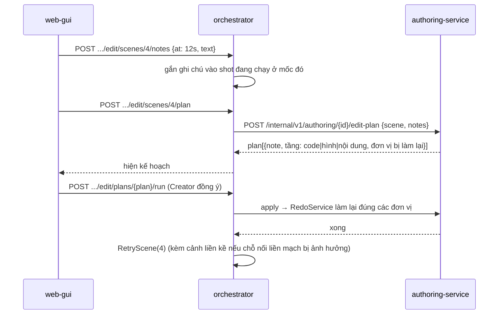

# CR-072 — Điều phối giữa các service

Mỗi chặng của luồng 17 bước: ai khởi động, ai làm, kết quả nằm ở đâu, Creator duyệt chỗ nào. Ký hiệu: **GW** api-gateway, **AU** authoring-service, **OR** orchestrator, **LLM** llm-service, **RE** rendering, **TTS**, **VA** video-assembly.

## Mẫu chung: một đơn vị được dựng, duyệt, sửa (ADR-0035)

```mermaid
sequenceDiagram
    participant W as web-gui
    participant AU as authoring-service
    participant G as UnitGenerator (theo loại)
    participant LLM as llm-service
    participant RE as rendering
    W->>AU: POST .../units/{kind}/{key}/redo {note}
    AU->>AU: đơn vị → redoing; lấy đơn vị bên cạnh làm ngữ cảnh
    AU-->>W: operation_id
    AU->>G: Generate(project, ref, note, neighbours)
    G->>LLM: /v1/chat hoặc /v2/code/* (prompt theo ngôn ngữ hình đang ghim)
    G->>RE: POST /v1/stills (nếu đơn vị có ảnh)
    G-->>AU: content, inputs
    AU->>AU: lưu content; MarkBuilt(ref, inputs); đơn vị → pending
    AU->>AU: DependencyTracker: đơn vị phụ thuộc vào ref → stale
    W->>AU: GET .../units (thấy pending và các đơn vị stale)
```

- **Sửa tay**: `PUT .../units/{kind}/{key}`. Đơn vị đổi nguồn thành `creator`; các đơn vị phụ thuộc thành `stale`. Trước khi lưu, web-gui gọi `GET .../impact` để hiện "sẽ làm lại".
- **Gom ghi chú**: `POST .../units/redo-notes` chạy một lượt cho mọi đơn vị có ghi chú trong phạm vi; mỗi đơn vị được làm lại với ghi chú của chính nó.
- **Duyệt bước**: bước đi tiếp được khi mọi đơn vị của bước là `approved` và không còn `stale`.

## Tiền kỳ

| Chặng | Khởi động | Thực hiện | Kết quả | Duyệt |
|---|---|---|---|---|
| 1 Khởi tạo | Creator nhập chủ đề | AU `SuggestArchetypes` (LLM) | project ở OR; ngôn ngữ hình ghim vào project (AU) | — |
| 2 Cấu hình | Creator | OR, AU lưu cài đặt | — | — |
| 3 Kịch bản | Creator bấm chạy | AU: logline → dàn ý → lời thoại theo cảnh (LLM) | đơn vị `logline`, `beat`, `script_scene` | logline; từng cảnh |
| 4 Mỹ thuật lượt 1 | duyệt kịch bản xong | AU `GenerateArtPass(1)`: mô tả (LLM), hình SVG/TSX theo kit của ngôn ngữ (LLM), ảnh tĩnh (RE `/v1/stills`) | `art_world`, `art_location`, `art_character`, `art_prop` | từng mục |
| 5 Storyboard | duyệt lượt 1 xong | AU theo cảnh (LLM, `/v1/storyboard/finalize` schema mới) | `board_scene` | từng cảnh |
| 6 Mỹ thuật lượt 2 | duyệt storyboard xong | AU `GenerateArtPass(2)`: color key, khung mẫu (RE `/v1/stills`) | `color_key`, `style_frame` | từng mục |
| 7 Giọng sơ bộ | duyệt lượt 2 xong (tự chạy) | OR `DispatchLines` → TTS → OR → AU (dưới) | `voice_line` | — |
| 8 Animatic | giọng xong | AU `AnimaticPlanFor`; RE dựng ảnh tĩnh từng shot; web-gui phát trong trình duyệt (ADR-0039) | `animatic_shot` | chốt nhịp |

### Giọng sơ bộ (ADR-0040)

```mermaid
sequenceDiagram
    participant AU as authoring-service
    participant OR as orchestrator
    participant TTS as tts
    participant SH as /shared
    AU->>OR: POST /internal/v1/projects/{id}/draft-voice (lượt 2 vừa duyệt, hoặc một câu vừa đổi)
    OR->>AU: GET /internal/v1/authoring/{id}/voice-lines?pending=1
    AU->>AU: tra từ điển phát âm, gắn cách đọc từng câu
    AU-->>OR: lines[{line_id, text, say_as, speed, pauses}]
    OR->>TTS: synthesize_lines (RabbitMQ)
    TTS->>SH: ghi file theo cache_key (nội dung + cách đọc)
    TTS-->>OR: lines_synthesized
    OR->>AU: POST /internal/v1/authoring/{id}/voice-lines/results
    AU->>AU: voice_line có file, thời lượng; animatic_shot phụ thuộc → stale
```

authoring-service tự gọi orchestrator khi có câu cần đọc (đã có client tới orchestrator, hiện dùng để đọc project), nên việc đọc không phụ thuộc trình duyệt còn mở. Creator sửa một câu (chữ hoặc cách đọc) thì chỉ câu đó vào lại danh sách chờ đọc. Bước TTS của saga sau này gửi `synthesize_speech` như cũ; file đã có theo cùng `cache_key` được dùng lại.

### Animatic trong trình duyệt (ADR-0039)

- web-gui gọi `GET /v1/projects/{id}/animatic`: mỗi shot có `still_url`, `audio_url`, `start`, `duration`, `line`.
- Ảnh tĩnh và file giọng được GW phát từ `/shared`, cùng cách `videoHandler.js` phát video.
- `AnimaticPlayer` xếp hình theo mốc thời gian, phát giọng từng câu, hiện phụ đề. Không có lượt render video nào.
- Sửa thời lượng chỉ đổi dữ liệu. Sửa câu thì đọc lại câu đó. Đổi khung tĩnh thì chỉ dựng lại ảnh tĩnh của shot đó.

## Sản xuất

| Chặng | Khởi động | Thực hiện | Kết quả | Duyệt |
|---|---|---|---|---|
| 9 Hình minh hoạ | chốt nhịp | AU `IllustrationPlanner` (chỉ phần thiếu), LLM vẽ, RE xem trước | `illustration` | từng hình (như hiện nay) |
| 10 Code | hình xong | AU `GenerateScene` từng cảnh (LLM `/v2/code/generate`, đoạn = cảnh); RE `/v1/check/remotion` | `code_shot` | shot lỗi chờ Creator chọn cách xử lý |
| 11 Validate | code xong | AU gom chẩn đoán; `FixFinding` chỉ khi Creator bấm | `Finding` | cảnh báo: bỏ qua hoặc sửa |
| 12 Review | validate xong | AU `Summary` | — | bắt đầu render |

Xem nhanh một shot: web-gui → AU `ShotPreview` → RE `POST /v1/previews/shot` (480p) → GW phát file.

Shot lỗi: llm-service trả chẩn đoán theo shot. Autofix máy móc chạy và được ghi lại; không có lượt AI tự sửa. Creator chọn chạy lại, chạy lại kèm ghi chú, sửa tay hoặc dán kết quả AI ngoài (giữ từ CR-050).

## Hậu kỳ

### Render từng cảnh (ADR-0038)

```mermaid
sequenceDiagram
    participant OR as orchestrator
    participant RE as rendering
    participant SH as /shared
    participant W as web-gui
    OR->>RE: render_scene × N (mỗi cảnh một lệnh; đoạn chồng, color key)
    RE-->>W: tiến độ theo khung (progress.fanout, có scene_key)
    RE->>SH: /shared/{id}/video/scenes/{scene}.mp4
    RE-->>OR: scene_rendered
    RE-->>OR: scene_render_failed {transient: true}
    OR->>RE: render_scene (thử lại một lần)
    RE-->>OR: scene_render_failed {transient: false, shot_key, frame}
    OR-->>W: cảnh chờ Creator: "Sửa shot lỗi" (mở bước Code) hoặc "Chạy lại cảnh"
```

- rendering nhận nhiều lệnh `render_scene` cùng lúc theo số worker cấu hình (chi tiết số worker ở NFR Design của U8).
- Huỷ một cảnh: OR gửi lệnh huỷ theo `scene_key`, dùng cơ chế huỷ hiện có của rendering.
- Khi mọi cảnh xong, OR gửi `assemble_video` với danh sách cảnh, đoạn chồng và kiểu nối.

### Dựng theo ghi chú



### Merge và QC

- VA ghép theo cảnh, cắt đoạn chồng, áp chuyển cảnh ở chỗ cắt, đặt giọng, trộn nhạc, chuẩn hoá −14 LUFS.
- VA gửi tiến độ theo chặng qua `progress.fanout`.
- VA chạy QC: 6 kiểm hiện có, cộng chỗ nối và khung đen. Mọi kết quả là cảnh báo; `QC_ENFORCE` giữ tắt.

### Publish

- AU `ComposeThumbnails` gọi RE `/v1/stills` với composition `Thumbnail`, 3 bố cục, chữ do Creator sửa.
- Ảnh được chọn ghi vào `/shared/{id}/thumbnail/`, chỗ publisher đang đọc.
- Prompt cho công cụ ngoài do AU sinh từ ngôn ngữ hình, thế giới, bảng màu; Creator tải ảnh lên như hiện nay.

## Ngôn ngữ hình (ADR-0036)

- **Bật một ngôn ngữ**: web-gui → AU `Activate`, trong cùng giao dịch tắt ngôn ngữ đang bật.
- **Project mới**: AU `PinForProject` ghim id và phiên bản của ngôn ngữ đang bật. Mọi prompt vẽ và mọi composition của project đó dùng bản đã ghim, kể cả khi sau này Creator bật ngôn ngữ khác.
- **Ảnh mẫu**: AU gọi RE `/v1/stills` với `LanguageSample` cho hai cảnh thử, mỗi ngôn ngữ một lượt; cache theo `kit_key`, phiên bản luật và cảnh.

## Sao lưu và xoá dữ liệu cũ (FR-16, khi U1 vào main)

Script vận hành chạy từ primary checkout, có bước xác nhận:
1. Dump DB orchestrator và authoring-service.
2. Nén `/shared`.
3. Chạy saga xoá project của OR cho từng project, để mỗi service tự dọn thư mục của mình (theo `shared-artifacts.md`).
4. Xoá prompt Creator đã sửa, luật style, thư viện hình và nền ở AU. Seeder gieo lại prompt hệ thống khi khởi động.
5. In báo cáo đã xoá gì và file sao lưu nằm ở đâu.
