# CR-072 — Phụ thuộc giữa các CR con

## Date
2026-10-13

Định nghĩa từng CR con: [`unit-of-work.md`](unit-of-work.md). Phụ thuộc ở đây là phụ thuộc thật: CR con sau dùng thành phần, dữ liệu hoặc hợp đồng mà CR con trước tạo ra. Thứ tự làm là tuần tự (U-5 B), nên một CR con có thể làm sau một CR con nó không phụ thuộc.

## Ma trận phụ thuộc

Dòng phụ thuộc cột. **●** phụ thuộc trực tiếp (ghi ở bảng "Dùng" bên dưới); **○** phụ thuộc gián tiếp, qua một CR con khác.

| CR con | U1 | U2a | U2b | U3 | U4a | U4b | U4c | U5 | U6 | U7a | U7b | U7c | U8a | U8b |
|---|---|---|---|---|---|---|---|---|---|---|---|---|---|---|
| U1 | | | | | | | | | | | | | | |
| U2a | | | | | | | | | | | | | | |
| U2b | | ● | | | | | | | | | | | | |
| U3 | | ○ | ● | | | | | | | | | | | |
| U4a | ● | ○ | ● | ● | | | | | | | | | | |
| U4b | ● | ○ | ● | ○ | ● | | | | | | | | | |
| U4c | ○ | ○ | ● | ○ | ○ | ● | | | | | | | | |
| U5 | ● | ○ | ● | ● | ● | ● | | | | | | | | |
| U6 | ● | ○ | ● | ○ | ● | ● | | ● | | | | | | |
| U7a | ● | ○ | ● | ○ | ○ | ○ | ● | ● | | | | | | |
| U7b | ● | | | | | | | | | | | | | |
| U7c | ○ | ○ | ● | ○ | ○ | ○ | ○ | ○ | | ● | | | | |
| U8a | ○ | ○ | ● | ○ | ○ | ○ | ○ | ● | | ● | | | | |
| U8b | ○ | ○ | ● | ○ | ○ | ○ | ○ | ○ | | ○ | | | ● | |
| U9 | ● | ○ | ● | ○ | ○ | ○ | | ● | | | | | | |

Thứ CR con sau dùng của CR con trước. Mọi CR con từ U3 trở đi, trừ U7b, đăng ký loại đơn vị của mình vào khung của U2b (`UnitGenerator`, bộ thành phần đơn vị ở web-gui); U8a và U8b dùng cùng mô hình đơn vị ở orchestrator (ADR-0035). Bảng dưới không nhắc lại phần đó.

| CR con | Dùng |
|---|---|
| U2b | U2a: cách thêm bước và giai đoạn trong ba bản định nghĩa luồng |
| U3 | — (chỉ khung đơn vị) |
| U4a | U1: ngôn ngữ đã ghim, kit `phatsang`, `/v1/stills`, phát file chung; U3: đơn vị `script_scene` làm đầu vào |
| U4b | U1: kit `phatsang`, `/v1/stills`; U4a: bối cảnh để đặt nhân vật lên, màn Mỹ thuật lượt 1, bốn cách sửa hình |
| U4c | U4b: bộ mỹ thuật đủ bốn mục để biết phần nào còn thiếu |
| U5 | U1: `/v1/stills` cho color key và khung mẫu; U3: `script_scene` làm đầu vào storyboard; U4a: bảng màu thế giới, bối cảnh; U4b: schema storyboard có nhân vật |
| U6 | U1: `/v1/stills` cho khung animatic, phát file chung cho file giọng; U4a, U4b: `art_*` cho khung tĩnh; U5: câu thoại trong `board_scene` |
| U7a | U1: kit `phatsang`; U4c: hình minh hoạ mà code đọc; U5: storyboard mới (cảnh, nhân vật, vật nối, color key) |
| U7b | U1: kit `phatsang` |
| U7c | U7a: chẩn đoán theo shot |
| U8a | U5: color key, cách nối cảnh; U7a: code theo cảnh |
| U8b | U8a: đơn vị `render_scene`, chạy lại từng cảnh; U2b: `RedoService` để làm lại đơn vị theo ghi chú |
| U9 | U1: `/v1/stills`; U5: `style_frame` |

Hai chỗ không phụ thuộc dù trông như có:
- **U7a không cần U6.** Code của shot nhận thời lượng làm props lúc render (ADR-0032). Cạnh `voice_line → code_shot` trong đồ thị đơn vị do CR con vào main sau (U7a) đăng ký.
- **U3 không cần U1.** Kịch bản không đọc luật hình.

## Thứ tự làm

```mermaid
flowchart LR
    U1["U1 Ngôn ngữ hình<br/>+ xoá dữ liệu cũ"] --> U2a["U2a Luồng 3 giai đoạn"]
    U2a --> U2b["U2b Khung đơn vị"] --> U3["U3 Kịch bản"]
    U3 --> U4a["U4a Thế giới, bối cảnh, đạo cụ"] --> U4b["U4b Nhân vật"] --> U4c["U4c Hình minh hoạ"]
    U4c --> U5["U5 Storyboard + lượt 2"] --> U6["U6 Giọng + animatic"]
    U6 --> U7a["U7a Code theo cảnh"] --> U7b["U7b Key pose, VFX"] --> U7c["U7c Validate, Review"]
    U7c --> U8a["U8a Render theo cảnh, Merge"] --> U8b["U8b Dựng"] --> U9["U9 Thumbnail, rà prompt"]
```

Mũi tên ở sơ đồ trên là thứ tự làm (U-5 B), không phải phụ thuộc. Phụ thuộc thật nằm ở ma trận. Nếu sau này Creator muốn mở song song, những cặp này không phụ thuộc nhau: U1 với U2a, U2b, U3; U4c với U5; U6 với U7a; U7b với mọi CR con từ U2a tới U6; U9 với U6..U8b.

## Luồng sau từng CR con

| Sau CR con | Số bước | Thay đổi trên thanh bước |
|---|---|---|
| U1, U2a, U2b, U3 | 13 | U2a chia vào ba giai đoạn và đổi tên bước theo luồng mục tiêu |
| U4a | 14 | thêm Mỹ thuật lượt 1 sau Kịch bản |
| U4b, U4c | 14 | — |
| U5 | 15 | thêm Mỹ thuật lượt 2 sau Storyboard |
| U6 | 16 | thêm Giọng sơ bộ và Animatic; bước Giọng đọc của saga rời thanh bước |
| U7a, U7b, U7c, U8a | 16 | — |
| U8b | 17 | thêm Dựng sau Render |

Mỗi lần đổi, cả ba bản định nghĩa luồng (orchestrator, authoring-service, web-gui) đổi cùng nhau và test hợp đồng giữ chúng khớp nhau (ADR-0034).

## Loại đơn vị theo CR con

| Loại đơn vị | Giữ ở | CR con đăng ký |
|---|---|---|
| Đơn vị của Kịch bản và Storyboard hiện có | authoring-service | U2b (U3 và U5 thay bằng dạng mới) |
| `logline`, `beat`, `script_scene` | authoring-service | U3 |
| `art_world`, `art_location`, `art_prop` | authoring-service | U4a |
| `art_character` | authoring-service | U4b |
| `illustration` | authoring-service | U4c |
| `board_scene` (dạng mới), `color_key`, `style_frame` | authoring-service | U5 |
| `voice_line`, `animatic_shot` | authoring-service | U6 |
| `code_shot` | authoring-service | U7a |
| `render_scene` | orchestrator | U8a |
| ghi chú dựng theo mốc | orchestrator | U8b |
| thumbnail | authoring-service | U9 |

## Đổi hợp đồng giữa service

| Hợp đồng | CR con thêm bản mới | CR con bỏ bản cũ |
|---|---|---|
| `POST /v1/stills`, `GET /v1/kits` (rendering) | U1 | — (mới) |
| Phát file chung từ `/shared` (api-gateway) | U1 | — (mới) |
| `/shared/stills/{hash}.png` | U1 | — |
| HTTP đơn vị `/v1/projects/{id}/units/...` | U2b | — |
| Storyboard `/v1/storyboard/finalize` | U4b (nhân vật), U5 (color key, cách nối) | — (chỉ thêm trường) |
| `/shared/{id}/uploads/moodboard/`, `/uploads/svg/` | U4a | — |
| `synthesize_lines`, `lines_synthesized` (RabbitMQ) | U6 | — (mới) |
| Khoá tên file giọng thêm cách đọc | U6 | U6 |
| `/v2/code/generate` với `segment_kind = "scene"` | U7a | U7a (đoạn theo số shot của CR-050) |
| `POST /v1/previews/shot`, `/shared/{id}/previews/` | U7a | — |
| `render_scene`, `scene_rendered`, `scene_render_failed` | U8a | `render_scenes` cả video: CR sau CR-072 (backlog) |
| `assemble_video` thêm `scenes[]` | U8a | U8a (trường `video_path` một file) |
| `/shared/{id}/video/scenes/` | U8a | — |
| `progress.fanout` thêm `scene_key`, `stage` | U8a | — |

Hợp đồng nào đổi thì `docs/contracts/README.md` và `docs/contracts/shared-artifacts.md` đổi trong cùng CR con.

## Chỗ nhiều CR con đụng cùng file

Làm tuần tự nên không có hai nhánh sửa cùng lúc. Bảng này để `/cr` của mỗi CR con biết phải đọc lại phần CR con trước vừa đổi.

| Chỗ | CR con đụng tới |
|---|---|
| Ba bản định nghĩa luồng: `services/orchestrator/internal/domain/flow.go`, `services/authoring-service/internal/domain/flow.go`, `services/web-gui/src/utils/flow.ts` | U2a, U4a, U5, U6, U8b |
| Prompt hệ thống (seed ở authoring-service) | U1, U3, U4a, U4b, U4c, U5, U6, U7a, U7b, U7c, U8b, U9 |
| Schema storyboard (`services/llm-service/app/storyboard.py`) | U4b, U5 |
| Kit Remotion `phatsang` (`services/rendering/remotion_project/`) | U1, U4a, U4b, U5, U6, U7b, U8a, U9 |
| Route của api-gateway | U1, U2b, U3, U4a, U6, U7a, U8a, U8b |
| `docs/contracts/shared-artifacts.md` | U1, U4a, U6, U7a, U8a, U9 |
