# CR-072 — Phụ thuộc giữa các CR con

## Date
2026-10-13 (cập nhật 2026-10-17: thứ tự theo luồng; sau đó cùng ngày: Tiền kỳ · Nội dung U3a..U3f, U2b gộp vào U3a và U5; Creator duyệt cùng ngày)

Định nghĩa từng CR con: [`unit-of-work.md`](unit-of-work.md). Phụ thuộc ở đây là phụ thuộc thật: CR con sau dùng thành phần, dữ liệu hoặc hợp đồng mà CR con trước tạo ra. Thứ tự làm là tuần tự (U-5 B), nên một CR con có thể làm sau một CR con nó không phụ thuộc.

## Phụ thuộc trực tiếp

Mọi CR con từ U3b trở đi, trừ U7b, đăng ký loại đơn vị của mình vào khung của U3a (`UnitGenerator`, bộ thành phần đơn vị ở web-gui); U8a và U8b dùng cùng mô hình đơn vị ở orchestrator (ADR-0035). Bảng dưới ghi phần đó là "U3a: khung" và chỉ nói thêm thứ khác. Phụ thuộc gián tiếp (qua một CR con khác) không ghi.

| CR con | Phụ thuộc trực tiếp | Dùng |
|---|---|---|
| U2a | — | — |
| U3a | U2a | thanh bước bốn nhóm, cách thêm bước ở ba bản định nghĩa luồng |
| U3b | U3a | khung; `brief` làm đầu vào sinh câu hỏi |
| U3c | U3a, U3b | khung; `fact` có mã và nhãn nguồn, trạng thái "Nghiên cứu bỏ qua" |
| U3d | U3a, U3c | khung; `story` (chuỗi nhân quả, payoff, dữ kiện dùng) |
| U3e | U3a, U3d | khung; `beat` (thứ tự, thời lượng, dữ kiện) |
| U3f | U3a, U3b, U3e | khung; `fact` và kết quả kiểm link cho máy kiểm; `script_beat` và thời lượng từ giọng thật |
| U1 | U3e | cách phát file chung từ `/shared` (cho ảnh mẫu) |
| U4a | U1, U3a, U3f | ngôn ngữ đã ghim, kit `phatsang`, `/v1/stills`; khung; `script_version` và `HandoffFor` (phần Mỹ thuật) |
| U4b | U1, U3a, U4a | kit `phatsang`, `/v1/stills`; khung; bối cảnh để đặt nhân vật lên, màn Mỹ thuật lượt 1, bốn cách sửa hình |
| U4c | U3a, U4b | khung; bộ mỹ thuật đủ bốn mục để biết phần nào còn thiếu |
| U5 | U1, U3a, U3f, U4a, U4b | `/v1/stills` cho color key và khung mẫu; khung (áp lên Storyboard); bản kịch bản đã chốt và phần bàn giao của Storyboard; bảng màu thế giới, bối cảnh; schema storyboard có nhân vật |
| U6 | U1, U3a, U3e, U4a, U4b, U5 | `/v1/stills` cho khung animatic; khung; đường đọc từng câu và phát file chung; `art_*` cho khung tĩnh; câu thoại trong `board_scene` |
| U7a | U1, U3a, U4c, U5 | kit `phatsang`; khung; hình minh hoạ mà code đọc; storyboard mới (cảnh, nhân vật, vật nối, color key) |
| U7b | U1 | kit `phatsang`, rig và thư viện dáng |
| U7c | U3a, U3f, U7a | khung; "phải giữ chính xác" của bộ bàn giao để kiểm hình; chẩn đoán theo shot |
| U8a | U3a, U5, U7a | khung; color key, cách nối cảnh; code theo cảnh |
| U8b | U3a, U8a | `RedoService` để làm lại đơn vị theo ghi chú; đơn vị `render_scene`, chạy lại từng cảnh |
| U9 | U1, U3a, U5 | `/v1/stills`; khung; `style_frame` |

Ba chỗ không phụ thuộc dù trông như có:
- **Tiền kỳ · Nội dung không cần U1.** Brief, nghiên cứu, câu chuyện, beat và lời thoại không đọc luật hình. Ô Ngôn ngữ hình ở màn Ý tưởng và Cấu hình do U1 thêm khi nó vào main.
- **U3e không cần U6.** Nghe thử chỉ cần chữ và giọng; cách đọc và từ điển phát âm thêm ở U6 trên cùng lệnh, chỉ thêm trường.
- **U7a không cần U6.** Code của shot nhận thời lượng làm props lúc render (ADR-0032). Cạnh `voice_line → code_shot` trong đồ thị đơn vị do CR con vào main sau (U7a) đăng ký.

## Thứ tự làm

Theo thứ tự các bước của luồng (Creator, 2026-10-17): việc ở bước sớm làm trước, Tiền kỳ → Sản xuất → Hậu kỳ. U2a là khung thanh bước của mọi bước nên đứng đầu. Tiền kỳ · Nội dung làm ngay sau U2a (Creator, 2026-10-17, câu 2 B), khung đơn vị dựng trong U3a. U1 đứng ngay trước bước đầu tiên dùng kit (Mỹ thuật lượt 1).

| # | CR con | Bước của luồng mục tiêu |
|---|---|---|
| 1 | U2a — Luồng ba giai đoạn, xoá dữ liệu cũ | thanh bước của cả luồng |
| 2 | U3a — Ý tưởng · creative brief, khung đơn vị | 1 Ý tưởng; khung duyệt và làm lại của mọi bước |
| 3 | U3b — Nghiên cứu và kiểm chứng | 3 Nghiên cứu |
| 4 | U3c — Xây dựng câu chuyện | 4 Câu chuyện |
| 5 | U3d — Beat sheet | 5 Beat sheet |
| 6 | U3e — Viết kịch bản, đọc giọng từng câu | 6 Viết kịch bản |
| 7 | U3f — Rà soát và chốt, bộ bàn giao | 7 Rà soát và chốt |
| 8 | U1 — Ngôn ngữ hình | ghim ngôn ngữ ở 1, 2; cài đặt; kit cho bước 8 trở đi |
| 9 | U4a — Thế giới, bối cảnh, đạo cụ | 8 Mỹ thuật lượt 1 |
| 10 | U4b — Nhân vật | 8 Mỹ thuật lượt 1 |
| 11 | U5 — Storyboard, Mỹ thuật lượt 2 | 9 Storyboard, 10 Mỹ thuật lượt 2 |
| 12 | U6 — Giọng sơ bộ, animatic | 11 Giọng sơ bộ, 12 Animatic |
| 13 | U4c — Hình minh hoạ theo bộ mỹ thuật | 13 Hình minh hoạ |
| 14 | U7a — Code theo cảnh | 14 Code |
| 15 | U7b — Bộ VFX, gọi dáng theo key pose | 14 Code |
| 16 | U7c — Validate, Review | 15 Validate, 16 Review |
| 17 | U8a — Render theo cảnh, Merge, QC | 17 Render từng cảnh, 19 Merge + QC |
| 18 | U8b — Dựng | 18 Dựng |
| 19 | U9 — Thumbnail, rà prompt | 20 Kết quả, 21 Publish |

Bước 2 Cấu hình không có CR con riêng (U2a thêm khối "Các chỗ bạn sẽ duyệt", U1 thêm ô Ngôn ngữ hình).

```mermaid
flowchart LR
    U2a["U2a Luồng 3 giai đoạn<br/>+ xoá dữ liệu cũ"] --> U3a["U3a Ý tưởng<br/>+ khung đơn vị"] --> U3b["U3b Nghiên cứu"] --> U3c["U3c Câu chuyện"]
    U3c --> U3d["U3d Beat sheet"] --> U3e["U3e Viết kịch bản<br/>+ đọc từng câu"] --> U3f["U3f Rà soát và chốt"]
    U3f --> U1["U1 Ngôn ngữ hình"] --> U4a["U4a Thế giới, bối cảnh, đạo cụ"] --> U4b["U4b Nhân vật"]
    U4b --> U5["U5 Storyboard + lượt 2"] --> U6["U6 Giọng + animatic"] --> U4c["U4c Hình minh hoạ"]
    U4c --> U7a["U7a Code theo cảnh"] --> U7b["U7b VFX, key pose"] --> U7c["U7c Validate, Review"]
    U7c --> U8a["U8a Render theo cảnh, Merge"] --> U8b["U8b Dựng"] --> U9["U9 Thumbnail, rà prompt"]
```

Mũi tên ở sơ đồ trên là thứ tự làm, không phải phụ thuộc; thứ tự giữ đúng mọi phụ thuộc ở bảng trên. Nếu sau này Creator muốn mở song song, những cặp này không phụ thuộc nhau: U1 với U3a..U3d; U4c với U5, U6; U6 với U7a; U7b với mọi CR con trừ U1; U9 với U6..U8b.

## Luồng sau từng CR con

| Sau CR con | Số bước | Thay đổi trên thanh bước |
|---|---|---|
| U2a | 13 | chia vào bốn nhóm (Tiền kỳ · Nội dung, Tiền kỳ · Hình ảnh, Sản xuất, Hậu kỳ); đổi tên bước theo mockup bản 8 |
| U3a | 13 | Ý tưởng thay Khởi tạo, thành chỗ duyệt ◆; "↻" ở bước có mục cần làm lại |
| U3b | 14 | thêm Nghiên cứu (tuỳ chọn) sau Cấu hình |
| U3c | 15 | thêm Câu chuyện sau Nghiên cứu |
| U3d | 16 | thêm Beat sheet sau Câu chuyện |
| U3e | 16 | Viết kịch bản thay Kịch bản |
| U3f | 17 | thêm Rà soát và chốt sau Viết kịch bản |
| U1 | 17 | — |
| U4a | 18 | thêm Mỹ thuật lượt 1 đầu nhóm Tiền kỳ · Hình ảnh |
| U4b | 18 | — |
| U5 | 19 | thêm Mỹ thuật lượt 2 sau Storyboard |
| U6 | 20 | thêm Giọng sơ bộ và Animatic; bước Giọng đọc của saga rời thanh bước |
| U4c, U7a, U7b, U7c | 20 | — |
| U8a | 20 | Render đổi tên thành Render từng cảnh |
| U8b | 21 | thêm Dựng sau Render từng cảnh |
| U9 | 21 | — |

Mỗi lần đổi, cả ba bản định nghĩa luồng (orchestrator, authoring-service, web-gui) đổi cùng nhau và test hợp đồng giữ chúng khớp nhau (ADR-0042).

## Loại đơn vị theo CR con

| Loại đơn vị | Giữ ở | CR con đăng ký |
|---|---|---|
| `brief` | authoring-service | U3a |
| `research_question`, `fact` | authoring-service | U3b (U3c thêm `fact` "chưa có nguồn" khi bỏ qua Nghiên cứu) |
| `story` | authoring-service | U3c |
| `beat` | authoring-service | U3d |
| `script_beat` (kèm file giọng từng câu) | authoring-service | U3e |
| `review_check`, `handoff_beat`, `glossary_term`; `script_version` (ảnh chụp khi chốt, không phải đơn vị duyệt) | authoring-service | U3f |
| `art_world`, `art_location`, `art_prop` | authoring-service | U4a |
| `art_character` | authoring-service | U4b |
| `illustration` | authoring-service | U4c |
| `board_scene`, `color_key`, `style_frame` | authoring-service | U5 |
| `voice_line`, `animatic_shot` | authoring-service | U6 |
| `code_shot` | authoring-service | U7a |
| `render_scene` | orchestrator | U8a |
| ghi chú dựng theo mốc | orchestrator | U8b |
| thumbnail | authoring-service | U9 |

## Đổi hợp đồng giữa service

| Hợp đồng | CR con thêm bản mới | CR con bỏ bản cũ |
|---|---|---|
| HTTP đơn vị `/v1/projects/{id}/units/...` | U3a | — |
| `POST /v1/projects` thêm thời lượng mục tiêu | U3a | — (chỉ thêm trường) |
| Mẫu dán `conceptflow.research.v1` | U3b | — (mới) |
| authoring-service gọi ra Internet (`SourceFetcher`, ADR-0043) | U3b | — (mới) |
| `synthesize_lines`, `lines_synthesized` (RabbitMQ) | U3e (chữ và giọng); U6 thêm trường cách đọc | — (mới; U6 chỉ thêm trường) |
| `/shared/{id}/audio/{line}_{cache_key}.wav` | U3e | U6 (khoá thêm cách đọc, đổi theo ba bước) |
| Phát file chung từ `/shared` (api-gateway) | U3e | — (mới) |
| `POST /v1/stills`, `GET /v1/kits` (rendering) | U1 | — (mới) |
| `/shared/stills/{hash}.png` | U1 | — |
| Storyboard `/v1/storyboard/finalize` | U4b (nhân vật), U5 (color key, cách nối) | — (chỉ thêm trường) |
| `/shared/{id}/uploads/moodboard/`, `/uploads/svg/` | U4a | — |
| `/v2/code/generate` với `segment_kind = "scene"` | U7a | U7a (đoạn theo số shot của CR-050) |
| `POST /v1/previews/shot`, `/shared/{id}/previews/` | U7a | — |
| `render_scene`, `scene_rendered`, `scene_render_failed` | U8a | `render_scenes` cả video: CR sau CR-072 (backlog) |
| `assemble_video` thêm `scenes[]` | U8a | U8a (trường `video_path` một file) |
| `/shared/{id}/video/scenes/` | U8a | — |
| `progress.fanout` thêm `scene_key`, `stage` | U8a | — |

Hợp đồng nào đổi thì `docs/contracts/README.md` và `docs/contracts/shared-artifacts.md` đổi trong cùng CR con.

## Chỗ nhiều CR con đụng cùng file

Làm tuần tự nên không có hai nhánh sửa cùng lúc. Bảng này để `/cr` của mỗi CR con biết phải đọc lại phần CR con trước vừa đổi.

| Chỗ | CR con đụng tới |
|---|---|
| Ba bản định nghĩa luồng: `services/orchestrator/internal/domain/flow.go`, `services/authoring-service/internal/domain/flow.go`, `services/web-gui/src/utils/flow.ts` | U2a, U3a, U3b, U3c, U3d, U3e, U3f, U4a, U5, U6, U8a, U8b |
| Màn Khởi tạo / Ý tưởng và tạo project (`ProjectDraftContext`, trang bước 1) | U3a (thay bằng Ý tưởng), U3c (chuyển chọn kiểu video sang Câu chuyện), U1 (ô Ngôn ngữ hình) |
| Bước Kịch bản hiện có (vai Story Architect, `story_content`, màn dàn ý và màn Kịch bản) | U3a, U3b, U3c, U3d (nối đầu vào mới), U3e (thay bằng Viết kịch bản) |
| Prompt Storyboard, Hình minh hoạ, Code đọc kịch bản | U3e (lời thoại theo beat), U3f (đọc bản đã chốt và bộ bàn giao), U4c, U5, U7a |
| Prompt hệ thống (seed ở authoring-service) | U1, U3a..U3f, U4a, U4b, U4c, U5, U6, U7a, U7b, U7c, U8b, U9 |
| tts (`synthesize_lines`, khoá cache) | U3e, U6 |
| Schema storyboard (`services/llm-service/app/storyboard.py`) | U4b, U5 |
| Kit Remotion `phatsang` (`services/rendering/remotion_project/`) | U1, U4a, U4b, U5, U6, U7b, U8a, U9 |
| Route của api-gateway | U1, U3a..U3f, U4a, U6, U7a, U8a, U8b |
| `docs/contracts/shared-artifacts.md` | U1, U3e, U4a, U6, U7a, U8a, U9 |
