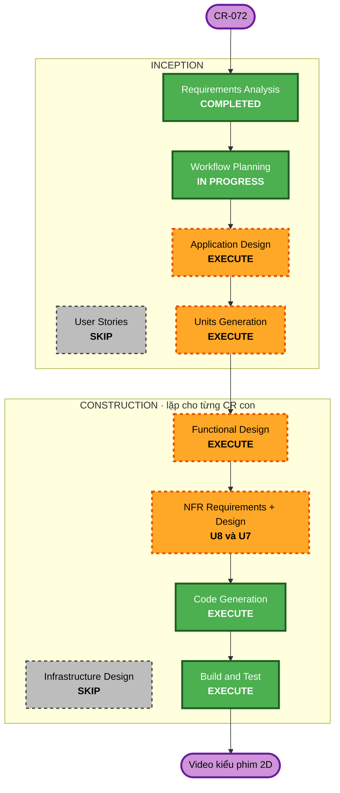
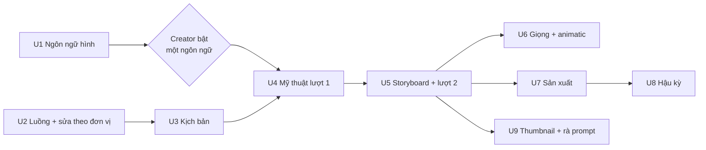

# CR-072 — Workflow Planning

Trạng thái: **đã duyệt** (Creator, 2026-10-13: "ok"). W-1 A, W-2 A, W-3 A.

## Date
2026-10-13

Yêu cầu đã duyệt: `aidlc-docs/inception/requirements/cr-072-2d-film-pipeline.md` (FR-1..FR-26, NFR-1..NFR-7; commit `2fbd770`). Câu hỏi và câu trả lời: `cr-072-requirement-questions.md`, `cr-072-clarification-questions.md`, `cr-072-prototype-review.md`. Prototype: https://claude.ai/artifact/HibBJUisUocqKXDZD57cTH.

## 1. Phân tích phạm vi và tác động

### Loại thay đổi
Thay đổi kiến trúc luồng làm video, đụng mọi service. Không đổi hạ tầng triển khai (vẫn Docker Compose, RabbitMQ, Postgres, volume `/shared`, Remotion trong rendering).

### Tác động theo service

| Service | Thay đổi chính | FR |
|---|---|---|
| orchestrator (Go) | Luồng 17 bước, 3 giai đoạn; trạng thái các bước mới; saga render theo cảnh; chạy lại từng cảnh | FR-1, FR-14, FR-17 |
| authoring-service (Go) | Ngôn ngữ hình; logline, tóm tắt; bộ thiết kế mỹ thuật; nhân vật và thư viện nhân vật; color key; ghi chú và làm lại theo đơn vị; đồ thị phụ thuộc; từ điển phát âm; prompt mới; gợi ý kiểu video | FR-2..FR-7, FR-15, FR-17..FR-20 |
| llm-service (Python) | Schema storyboard mới (nhân vật tham chiếu, color key, hành trình máy quay); code theo cảnh; bỏ lượt AI tự sửa | FR-4, FR-6, FR-8, FR-22 |
| rendering (Python + Remotion) | Bộ rig và hình theo ngôn ngữ hình; ảnh tĩnh cho bộ mỹ thuật, khung mẫu, animatic, thumbnail (`renderStill`); key pose; VFX; xem nhanh từng shot; render từng cảnh có đoạn chồng; chỉnh màu theo cảnh | FR-3, FR-10..FR-12, FR-14, FR-21, FR-22 |
| tts (Python) | Chạy sớm; "đọc là", tốc độ, khoảng nghỉ (SSML Azure); từ điển phát âm | FR-9, FR-20 |
| video-assembly (Python) | Ghép theo cảnh, khớp đoạn chồng, chuyển cảnh ở chỗ cắt; tiến độ theo chặng; QC chỗ nối và khung đen | FR-14, FR-26 |
| api-gateway (Node) | Route mới cho các màn mới, tải ảnh tham khảo, tải SVG | FR-3, FR-17..FR-21 |
| web-gui (React) | Thanh bước 3 giai đoạn; các màn mới; khung duyệt và làm lại theo đơn vị; trang Ngôn ngữ hình, Thư viện nhân vật, Từ điển phát âm | tất cả |

### Tác động khác
- **Dữ liệu**: bảng mới (ngôn ngữ hình, bộ mỹ thuật, nhân vật, color key, ghi chú, từ điển phát âm); storyboard đổi dạng; xoá dữ liệu cũ một lần (FR-16).
- **Hợp đồng**: `docs/contracts/shared-artifacts.md` (file theo cảnh, ảnh tĩnh); HTTP authoring-service ↔ llm-service ↔ rendering (schema storyboard, code theo cảnh). Đổi theo ba bước: thêm bản mới, giữ bản cũ, bỏ bản cũ ở lần sau.
- **NFR**: render chậm hơn vì glow và hạt, bù bằng render song song theo cảnh (NFR-1); đo tỉ lệ duyệt ngay lần đầu (NFR-2).

### Rủi ro
- **Mức rủi ro**: Cao. Đụng mọi service, đổi dạng dữ liệu, xoá dữ liệu cũ, chất lượng đầu ra của AI chưa đo được (bộ mỹ thuật, khung mẫu, cảnh giải thích ý trong thế giới).
- **Quay lui**: theo từng CR con; mỗi CR con vào main khi luồng vẫn chạy trọn từ đầu đến cuối. Xoá dữ liệu cũ chỉ quay lui được bằng file sao lưu.
- **Kiểm thử**: phức tạp. Mỗi CR con có test của service, cộng một lần chạy trọn luồng trên stack thật do Creator bấm (tốn token).

## 2. Các stage sẽ làm

| Stage | Làm? | Lý do |
|---|---|---|
| User Stories | Bỏ | Creator là người dùng duy nhất; các màn đã mô tả trong yêu cầu và prototype (Creator duyệt khi chốt yêu cầu) |
| Application Design | Làm | Có thành phần mới: kho ngôn ngữ hình, khung duyệt và làm lại theo đơn vị cùng đồ thị phụ thuộc, bộ mỹ thuật, thư viện nhân vật, từ điển phát âm, render theo cảnh. Viết ở đây 3 ADR đã nêu trong yêu cầu, và ADR cho khung sửa theo đơn vị |
| Units Generation | Làm | Chốt ranh giới, giao diện và thứ tự của các CR con ở mục 3 |
| Functional Design | Làm, cho từng CR con | Mỗi CR con có dữ liệu, prompt và luật riêng |
| NFR Requirements + Design | Chỉ U7 và U8 | U7: xem nhanh từng shot phải nhanh (mục tiêu khoảng 10 giây một shot). U8: số cảnh render song song theo CPU và bộ nhớ, đoạn chồng, tự chạy lại khi lỗi tạm thời |
| Infrastructure Design | Bỏ | Không đổi hạ tầng; chỉ thêm bảng, cột và thư mục trong `/shared` (ghi ở Functional Design và `shared-artifacts.md`) |
| Code Generation, Build and Test | Làm, cho từng CR con | Theo `/cr` → `/code` → `/deliver` như hiện nay |

## 3. Chia CR con và thứ tự (AI đề xuất, câu 16)

Nguyên tắc chia:
- Làm phần móng trước: ngôn ngữ hình (P-4 A: chốt trước CR con đầu tiên), luồng và khung sửa theo đơn vị.
- Sau đó làm theo thứ tự luồng: tiền kỳ → sản xuất → hậu kỳ.
- Mỗi CR con vào main khi luồng vẫn chạy trọn từ đầu tới video. Bước chưa làm thì giữ như hiện nay, không có bước giả.

| # | CR con | FR | Phụ thuộc | Cỡ |
|---|---|---|---|---|
| U1 | **Ngôn ngữ hình của kênh**: trang cài đặt, 4 ngôn ngữ hệ thống (luật hình, luật nền, rig cơ sở), bộ ảnh mẫu cùng hai cảnh thử, chỉ một bật, video giữ phiên bản; xoá dữ liệu cũ sau khi sao lưu | FR-18, FR-15 (phần luật hình và nền), FR-16 | — | L |
| — | **Cổng chọn ngôn ngữ**: Creator xem ảnh mẫu của 4 ngôn ngữ và bật một (P-4 A). Các CR con sau viết prompt theo ngôn ngữ đã bật | — | U1 | — |
| U2 | **Luồng 3 giai đoạn và khung sửa theo đơn vị**: thanh bước chia giai đoạn; mô hình đơn vị (mục, cảnh, shot, câu) có trạng thái chờ duyệt / đã duyệt / đang làm lại; ghi chú, gom ghi chú; đồ thị phụ thuộc để chỉ làm lại phần bị ảnh hưởng; áp ngay cho Kịch bản và Storyboard hiện có (duyệt và làm lại theo cảnh) | FR-1, FR-17 | — (làm song song với U1 được) | XL |
| U3 | **Kịch bản mới**: logline, tóm tắt, dàn ý theo beat, lời thoại theo cảnh; gợi ý kiểu video, AI đề xuất kiểu mới | FR-2, FR-19 | U2 | M |
| U4 | **Bộ mỹ thuật lượt 1**: thế giới, bối cảnh, nhân vật, đạo cụ; bảng tham khảo, ảnh tải lên; nhân vật cấp video và thư viện nhân vật; phong cách theo thế giới; Hình minh hoạ bám bộ mỹ thuật | FR-3 (mục 1–4), FR-4, FR-5, FR-13 | U1, U2, U3 | XL |
| U5 | **Storyboard mới và lượt 2**: hành trình máy quay, color key và hành trình màu, cảnh giải thích ý trong thế giới (ADR thay FR7 của CR-067), khung mẫu | FR-3 (mục 5–6), FR-6, FR-7, FR-8 | U4 | L |
| U6 | **Giọng sơ bộ và animatic**: TTS chạy sớm, "đọc là", từ điển phát âm, animatic khung tĩnh sửa theo shot, ghi chú nhịp | FR-9, FR-10, FR-20 | U5 | L |
| U7 | **Sản xuất**: code theo cảnh, lỗi theo shot, bỏ lượt AI tự sửa (giữ autofix máy móc), xem nhanh từng shot; rig key pose; bộ VFX; Validate đúng chỗ; Review đủ thông tin | FR-11, FR-12, FR-22, FR-23, FR-24 | U5 | XL |
| U8 | **Hậu kỳ**: render từng cảnh có đoạn chồng và chỉnh màu theo color key, lỗi theo cảnh, tự chạy lại lỗi tạm thời; Dựng theo ghi chú mốc thời gian; Merge có tiến độ, QC chỗ nối và khung đen | FR-14, FR-25, FR-26 | U7 | XL |
| U9 | **Thumbnail bằng Remotion**, prompt cho AI ngoài theo style của video; rà lại toàn bộ prompt cho khớp luồng mới | FR-21, FR-15 (phần còn lại) | U5 (khung mẫu); làm song song với U6–U8 được | M |

Cỡ: M khoảng một CR thường; L khoảng 1,5–2 CR; XL lớn hơn, có thể tách tiếp ở Units Generation.

**Đi song song được**: U1 với U2 (khác service phần lớn: U1 ở rendering, authoring luật; U2 ở orchestrator, web-gui). U6, U7 và U9 sau U5 (U7 với U6 cùng đụng storyboard nhưng khác phần; báo trùng khi mở từng CR con).

**Theo dõi chất lượng sau mỗi CR con**: Creator chạy một video thật qua luồng (tốn token). AI so tỉ lệ duyệt ngay lần đầu (NFR-2) giữa các lần chạy để biết prompt nào cần tối ưu.

## 4. Câu hỏi cho Creator

## Question W-1 — Đặt tên và nhánh cho CR con

A) Giữ CR-072 làm CR mẹ. Mỗi CR con là `CR-072-U<N>`, nhánh `feature/cr-072-u<N>-<slug>`, worktree riêng, vào main riêng. Nhánh hiện tại (`feature/cr-072-2d-film-pipeline`) chỉ chứa tài liệu Inception, vào main khi Inception xong (AI đề xuất).
   - ✅ Ưu: nhìn tên là biết thuộc CR-072; tài liệu chung một chỗ.
   - ⚠️ Nhược: tên nhánh khác kiểu `cr-<NNN>-<slug>` một chút.

B) Mỗi CR con một số CR mới (CR-073, CR-074…), ghi "thuộc CR-072" trong tài liệu.
   - ✅ Ưu: đúng hẳn kiểu đặt tên hiện tại.
   - ⚠️ Nhược: khó nhìn ra các CR cùng một kế hoạch.

X) Other (please describe after [Answer]: tag below)

[Answer]: A — AI hiểu từ "ok" (Creator duyệt kế hoạch, 2026-10-13), theo đề xuất của AI; báo lại Creator để sửa nếu hiểu sai.

## Question W-2 — Thời điểm xoá dữ liệu cũ

A) Xoá khi U1 vào main: luật hình và thư viện viết lại từ U1, và Creator muốn làm lại từ đầu (AI đề xuất). Trước khi xoá, AI dump DB và nén `/shared`; video đã đăng YouTube không bị đụng tới.
   - ⚠️ Nhược: từ lúc đó tới khi U4 xong, video mới làm theo luồng cũ nhưng với ngôn ngữ hình mới.

B) Xoá khi U4 vào main (lúc storyboard đổi dạng).
   - ⚠️ Nhược: dữ liệu và thư viện cũ còn lẫn với luật mới thêm một thời gian.

X) Other (please describe after [Answer]: tag below)

[Answer]: A — AI hiểu từ "ok" (Creator duyệt kế hoạch, 2026-10-13), theo đề xuất của AI; báo lại Creator để sửa nếu hiểu sai.

## Question W-3 — Thứ tự

A) Như bảng trên: móng → tiền kỳ → sản xuất → hậu kỳ (AI đề xuất).

B) Đưa U8 (render từng cảnh, dựng) lên ngay sau U2, vì nó bớt thời gian render lại cả video sớm hơn. Màu theo color key và đoạn chồng ở chỗ nối liền mạch thêm vào sau, khi U5 xong.
   - ⚠️ Nhược: U8 phải làm hai lần (trước và sau khi có color key, hành trình máy quay).

X) Other (please describe after [Answer]: tag below)

[Answer]: A — AI hiểu từ "ok" (Creator duyệt kế hoạch, 2026-10-13), theo đề xuất của AI; báo lại Creator để sửa nếu hiểu sai.

## 5. Bước tiếp theo

Sau khi Creator duyệt kế hoạch này (và trả lời W-1..W-3):
1. **Application Design**: thành phần và giao diện mới, 4 ADR (luồng 3 giai đoạn và bộ mỹ thuật; phong cách theo thế giới thay FR7 của CR-067; render theo cảnh; ngôn ngữ hình của kênh), cùng ADR khung sửa theo đơn vị.
2. **Units Generation**: chốt từng CR con (phạm vi, giao diện giữa các CR con, tiêu chí xong), tách tiếp các CR con cỡ XL nếu cần.
3. Đưa nhánh tài liệu CR-072 vào main, rồi mở CR con đầu tiên bằng `/cr` (U1, và U2 nếu làm song song).
